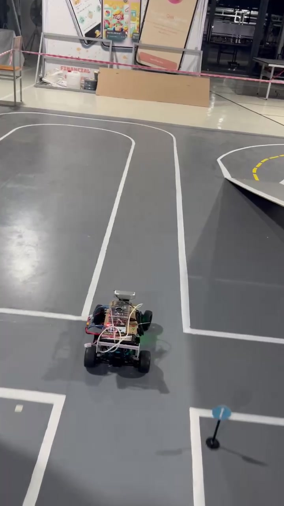
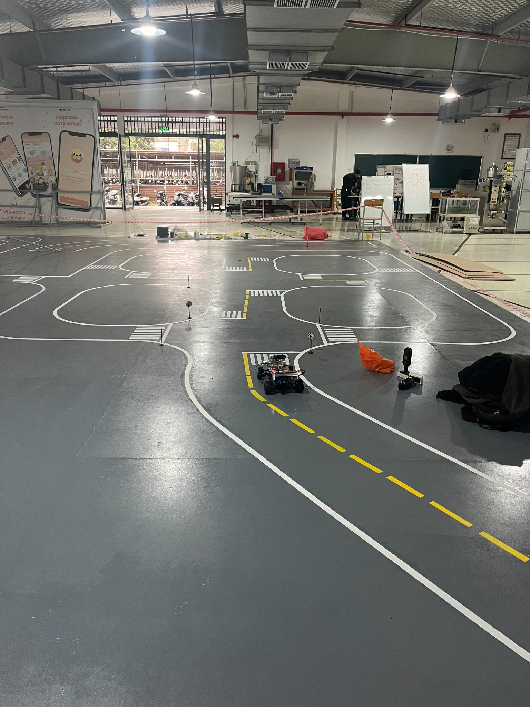

# AI-Based Autonomous Vehicle Competition

## 🏆 Second Prize

(


A computer-vision-based autonomous vehicle developed for the university-level  
**Autonomous Vehicle Using Image Processing and Artificial Intelligence Competition 2025**.

The project achieved **Second Prize** in the competition.

---

## 🎬 Simulation Demo

[](https://youtu.be/2UDqsYv0B6Y)

> Click the image above to watch the Unity simulation featuring semantic road segmentation, traffic-sign detection, object detection, and PID-based autonomous navigation.

---

## 🚗 Competition Vehicle Demo

[Watch the physical autonomous vehicle running on the competition track](assets/autonomous-vehicle-demo.mp4)

> This video shows the physical vehicle during testing on the competition track.

---

## 🏁 Competition Environment

The vehicle was tested on a predefined track containing lane markings, curves, intersections, traffic signs, traffic lights, and obstacle scenarios.



---

## 🔗 Project Overview

The project combines computer vision, deep learning, navigation logic, and vehicle control to enable a small autonomous vehicle to navigate a predefined competition track.

During simulation testing, the Unity-based simulator sends camera frames to the Python controller through TCP communication. The controller processes each frame, determines the driving decision, and sends steering and speed commands back to the simulator.

The system integrates:

- Semantic road segmentation
- Lane-following logic
- Traffic-sign recognition
- Person and vehicle detection
- Intersection detection
- Turn-decision logic
- PID-based steering control
- Adaptive speed control

### Processing Pipeline

```text
Unity Simulator
      │
      │ Camera frames through TCP
      ▼
Computer Vision System
      ├── Road segmentation
      ├── Lane detection
      ├── Traffic-sign detection
      ├── Person and vehicle detection
      ├── Intersection detection
      └── Navigation decision
      │
      ▼
PID Steering and Speed Control
      │
      │ Steering and speed commands
      ▼
Unity Simulator
```

---

## ✨ Main Features

- Road segmentation using **DeepLabV3-ResNet50**
- Lane extraction and center-line estimation
- Custom traffic-sign detection using **Ultralytics YOLO**
- Person and vehicle detection using **YOLOv8**
- Intersection detection and turn-decision logic
- Multi-frame stability filtering for traffic signs and navigation decisions
- PID-based steering control
- Adaptive speed control based on steering angle
- Obstacle detection and vehicle-stopping logic
- TCP communication with a Unity-based simulator
- Debug visualization for segmentation, detection, and navigation processing

---

## 🚦 Traffic-Sign Classes

The traffic-sign detection model supports the following classes:

```text
no_straight
no_turn_left
no_turn_right
stop
straight
turn_left
turn_right
unknown
```

---

## 🧠 Technologies

### Programming

- Python

### Computer Vision and AI

- OpenCV
- PyTorch
- Torchvision
- Ultralytics YOLO
- YOLOv8
- DeepLabV3
- ResNet50
- Semantic Segmentation
- Object Detection
- Image Processing

### Navigation and Control

- PID Control
- Lane Following
- Intersection Detection
- Traffic-Sign Recognition
- Adaptive Speed Control
- Multi-frame Stability Filtering
- Obstacle-Stopping Logic

### Communication and Simulation

- TCP Socket Communication
- JSON Data Processing
- Base64 Image Transmission
- Unity-based Simulator

---

## 📁 Repository Structure

```text
ai-autonomous-vehicle-competition/
├── assets/
│   ├── autonomous-vehicle-demo.mp4
│   ├── competition-track.jpg
│   ├── demo-thumbnail.jpg
│   └── second-prize.png
│
├── docs/
│   ├── algorithm-overview.md
│   ├── model-setup.md
│   └── system-architecture.md
│
├── experiments/
│   ├── opencv_lane_following_controller.py
│   ├── pid_control.py
│   ├── record.py
│   ├── road.py
│   ├── segmentation_obstacle_controller.py
│   └── webcam_person_alert.py
│
├── legacy/
│   ├── competition_controller_without_obstacle_detection.py
│   └── opencv_lane_client_legacy.py
│
├── src/
│   ├── communication/
│   │   ├── __init__.py
│   │   └── simulator_client.py
│   │
│   ├── control/
│   │   ├── __init__.py
│   │   └── pid.py
│   │
│   ├── models/
│   │   ├── __init__.py
│   │   └── segmentation.py
│   │
│   ├── navigation/
│   │   ├── __init__.py
│   │   └── filters.py
│   │
│   ├── vision/
│   │   ├── __init__.py
│   │   └── lane.py
│   │
│   ├── competition_controller.py
│   ├── config.py
│   └── main.py
│
├── tests/
├── tools/
├── weights/
│
├── .env.example
├── .gitignore
├── README.md
└── requirements.txt
```

---

## ⚙️ Installation

### 1. Clone the repository

```bash
git clone https://github.com/Letuthienan1112006/ai-autonomous-vehicle-competition.git
cd ai-autonomous-vehicle-competition
```

### 2. Create a virtual environment

```bash
python -m venv .venv
```

Activate the virtual environment on Windows:

```bash
.venv\Scripts\activate
```

Activate the virtual environment on Ubuntu or Linux:

```bash
source .venv/bin/activate
```

### 3. Install dependencies

```bash
pip install -r requirements.txt
```

---

## 📦 Model Weights

The trained model weights are not included in this repository.

Place the required files inside the `weights/` directory:

```text
weights/
├── segmentation.tar
├── detectsign.pt
└── yolov8n.pt
```

The expected model paths can be configured using environment variables:

```env
SEGMENTATION_WEIGHT=weights/segmentation.tar
TRAFFIC_SIGN_WEIGHT=weights/detectsign.pt
OBJECT_DETECTION_WEIGHT=weights/yolov8n.pt
```

Do not upload private datasets, restricted model files, API keys, passwords, or access tokens.

---

## 🖥️ Simulator Configuration

The default simulator connection is:

```env
SIMULATOR_HOST=127.0.0.1
SIMULATOR_PORT=54321
```

The simulator sends camera frames to the Python controller through TCP communication.

The controller:

1. Receives and decodes the camera frame.
2. Performs road segmentation and object detection.
3. Detects traffic signs and intersections.
4. Calculates the steering angle and vehicle speed.
5. Sends the control command back to the simulator.

---

## ▶️ Running the Project

Start the Unity-based simulator first.

Then open a terminal in the project directory and activate the Python environment:

```bash
source .venv/bin/activate
```

Run the main program:

```bash
python src/main.py
```

The full competition controller is located at:

```text
src/competition_controller.py
```

Some scripts inside `experiments/` and `legacy/` are retained as technical references from earlier development stages.

---

## 👨‍💻 My Contributions

**Computer Vision Team Member**

- Contributed to the development of computer vision algorithms
- Supported road segmentation and lane-following implementation
- Worked on traffic-sign recognition and intersection-handling logic
- Assisted with person and vehicle detection
- Participated in autonomous navigation development
- Supported system integration and competition-track testing
- Helped tune steering, speed, confidence thresholds, and stability parameters
- Tested the vision and navigation system in both simulation and physical track environments

---

## 🏅 Achievement

**Second Prize**  
**Autonomous Vehicle Using Image Processing and Artificial Intelligence Competition 2025**

The competition required the autonomous vehicle to navigate a predefined track containing:

- Lane markings
- Curved roads
- Intersections
- Traffic signs
- Traffic lights
- Obstacles and other vehicles

---

## 📚 Full Documentation

Detailed documentation about the system design, algorithms, development process, and competition project is available here:

[Read the full project documentation](https://cds-ute-documentation-project.readthedocs.io/en/latest/index.html)

---

## ⚠️ Limitations

- The project depends on a Unity-based simulator that is not included in this repository.
- Custom traffic-sign and segmentation model weights are not publicly included.
- The original development environment may require additional configuration.
- Some experimental scripts are retained for reference and may not represent the final competition version.
- Obstacle detection was developed as a competition prototype rather than a production-level autonomous-driving system.
- Performance may vary depending on lighting conditions, simulator settings, and camera input.

---

## 🚀 Future Improvements

- Convert PyTorch models to ONNX
- Optimize inference using TensorRT
- Improve object-distance estimation
- Add object tracking using ByteTrack or DeepSORT
- Improve lane and intersection detection under changing lighting conditions
- Add automated FPS and latency benchmarks
- Improve software modularity and unit-test coverage
- Add camera calibration and perspective transformation
- Add support for real embedded hardware deployment
- Improve the integration between perception, planning, and vehicle control

---

## 👥 Contributors

- **Le Tu Thien An** — Computer Vision Team Member
- Other project members contributed to hardware development, vehicle control, software integration, system testing, and competition preparation.

---

## 📄 Project Status

This repository is maintained as a technical portfolio and record of the autonomous vehicle developed for the 2025 university competition.

The original source code has been reorganized to improve readability, documentation, maintainability, and project presentation.
