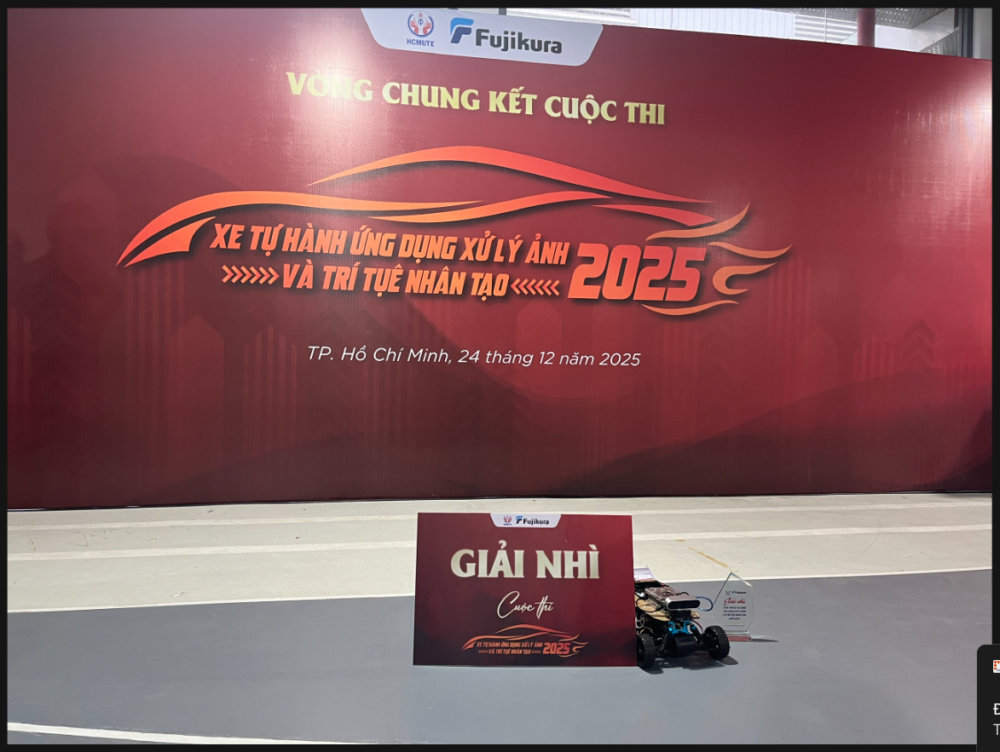

# AI-Based Autonomous Vehicle Competition


A computer-vision-based autonomous vehicle developed for the university-level
**Autonomous Vehicle Using Image Processing and Artificial Intelligence
Competition 2025**.

🏆 **Second Prize**



## Project Overview

The project processes camera frames from a Unity-based simulator and sends
steering and speed commands back through TCP. It combines semantic
segmentation, traffic-sign detection, obstacle detection, intersection logic,
and PID control.

## Main Features

- Road segmentation using **DeepLabV3-ResNet50**
- Custom traffic-sign detection using **Ultralytics YOLO**
- Person and vehicle detection using **YOLOv8**
- Intersection detection and turn-decision logic
- Multi-frame stability filters for traffic signs and turn decisions
- PID-based steering and adaptive speed control
- TCP communication with a Unity simulator
- Timed stopping when a person or vehicle is detected

## My Contribution

**Computer Vision Team Member**

- Contributed to image-processing and autonomous-navigation algorithms
- Supported traffic-sign recognition and intersection handling
- Participated in system integration, parameter tuning, and track testing

## Repository Structure

```text
├── assets/                      # Competition images
├── docs/                        # Architecture, code map, and results
├── experiments/                 # Alternative development experiments
├── legacy/                      # Older versions kept for reference
├── src/
│   ├── communication/           # Robust TCP JSON client
│   ├── models/                  # DeepLabV3 model definition
│   ├── config.py                # Paths and simulator configuration
│   ├── competition_controller.py
│   └── main.py
├── tools/                       # Camera and detection utilities
├── weights/                     # Local model weights (not committed)
├── .env.example
├── .gitignore
├── requirements.txt
└── README.md
```

## Setup

### Requirements

- Python 3.8 or later
- Unity simulator used by the project
- Project-specific segmentation and traffic-sign weights

### 1. Clone the repository

```bash
git clone https://github.com/Letuthienan1112006/ai-autonomous-vehicle-competition.git
cd ai-autonomous-vehicle-competition
```

### 2. Create a virtual environment

```bash
python3 -m venv .venv
source .venv/bin/activate
pip install -r requirements.txt
```

> NVIDIA Jetson devices may require NVIDIA-provided PyTorch and torchvision
> packages instead of the standard PyPI builds.

### 3. Add model weights

Place the project-specific weights in:

```text
weights/segmentation.tar
weights/detectsign.pt
```

See [`weights/README.md`](weights/README.md) for configuration options.

### 4. Start the simulator and run

```bash
python src/main.py
```

Default simulator address: `127.0.0.1:54321`.

## Important Fixes in This Clean Version

- Removed hard-coded `/mnt/big/...` model paths
- Added configurable model and simulator settings
- Replaced unsafe single-`recv` JSON parsing with buffered TCP decoding
- Fixed an invalid confidence threshold (`50.6` → `0.6`)
- Renamed and separated main, experimental, utility, and legacy scripts
- Added readable missing-weight errors, unit tests, CI, and project documentation

## Current Limitations

- Custom segmentation and traffic-sign weights are not included
- The original Unity simulator is required for complete execution
- Some experimental scripts still reflect the competition development stage
- Detection and navigation metrics have not yet been formally benchmarked

## Future Work

- Split the large controller into smaller vision, control, and state modules
- Benchmark FPS, latency, and navigation success rate
- Export models to ONNX/TensorRT for edge deployment
- Add automated tests for TCP parsing and navigation-state transitions

## Achievement

The project received **Second Prize** in the 2025 university autonomous
vehicle competition using image processing and artificial intelligence.
